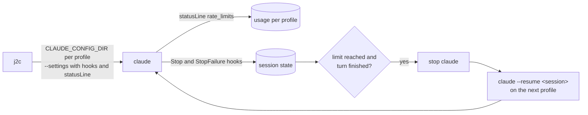

**English** | [Português](README.pt-BR.md)

# julius2claude

Multi-account routing and usage-limit failover for Claude Code.

<p align="center">
  <a href="https://tenor.com/view/money-terry-crews-spilled-milk-thrifty-gif-7197529"></a>
</p>

[](https://www.npmjs.com/package/julius2claude)
[](https://github.com/gabrielvieiraf/julius2claude/actions/workflows/ci.yml)
[](LICENSE)

## Overview

julius2claude (command `j2c`) runs the official Claude Code CLI across several accounts that belong
to you: a personal Claude Pro or Max plan, a company Team or Enterprise plan, Amazon Bedrock,
Google Vertex AI, Microsoft Foundry, or an Anthropic API key.

Each account keeps its own login. Conversation history is shared between accounts of the same
group. When the active account reaches its 5-hour or weekly usage limit, the session can move to
the next account at the end of the current reply and resume the same conversation in the same
directory.

## Features

- **Profiles per account.** Each profile runs Claude Code with its own `CLAUDE_CONFIG_DIR`, the
  setup Anthropic documents for using several accounts. Credentials are never copied between
  profiles.
- **Limit failover (opt-in).** Detects the 5-hour, weekly and per-model weekly limits and moves the
  session to the next eligible profile at a turn boundary.
- **No interrupted work.** A switch never happens during a tool call. Proactive switches wait for
  background subagents and background shell tasks to finish.
- **Cloud and API providers.** Amazon Bedrock, Google Vertex AI, Microsoft Foundry and API key
  profiles. Pay-per-token profiles are only used automatically when explicitly allowed.
- **Directory bindings.** Bind a directory to a profile, optionally in strict mode, so a company
  repository only runs on the company account.
- **Data groups.** Profiles in different groups never share history, and a session never moves
  across groups.
- **Crash recovery.** Sessions interrupted mid-reply by a crash, a WSL restart or a closed terminal
  can be listed and resumed with `j2c recover`.
- **Claude Code integration.** `/j2c:use`, `/j2c:next` and `/j2c:status` commands, plus a status
  line with the active profile and its usage.

## Requirements

- Claude Code 2.1.152 or later (2.1.248 or later recommended)
- Node.js 18 or later
- Linux, WSL2 or macOS. Native Windows support is experimental.

## Installation

```bash
npm install -g julius2claude
```

To install the latest commit from GitHub instead:

```bash
npm install -g github:gabrielvieiraf/julius2claude
```

## Quick start

```bash
j2c setup              # registers your current Claude Code login as the "main" profile
j2c add work           # adds a second account and opens its login
j2c                    # starts Claude Code; accepts the same arguments as `claude`
```

Automatic switching is disabled by default:

```bash
j2c auto on
```

To route every session through julius2claude, add `alias claude=j2c` to your shell profile.

## Configuration

### Profiles

```bash
j2c add work                                         # claude.ai account (Pro, Max, Team, Enterprise)
j2c add corp --group company                         # separate data group
j2c add aws --bedrock --aws-profile dev --region us-east-1
j2c add gcp --vertex --project my-project --region us-east5
j2c add az --foundry --resource my-foundry
j2c add api --api-key-helper "op read op://dev/anthropic/key"
j2c login <profile>                                  # log in again
j2c remove <profile> [--purge]
```

julius2claude does not store secrets. Bedrock and Vertex profiles use the standard AWS and Google
Cloud credential chains. API keys are read at runtime from the command passed to
`--api-key-helper`. A Bedrock profile can also be configured with `/setup-bedrock` inside a
session started with `j2c -P <profile>`.

### Failover order and automatic switching

```bash
j2c order main work aws
j2c auto on [--paid] [--5h 95] [--weekly 98] [--dwell 10]
j2c auto off
```

| Option | Default | Description |
|---|---|---|
| `--5h` | 95 | Switch when the 5-hour window reaches this percentage |
| `--weekly` | 98 | Switch when the weekly window reaches this percentage |
| `--dwell` | 10 | Minimum minutes on a profile before a proactive switch |
| `--paid` | off | Allow automatic failover to pay-per-token profiles |

A profile that refuses a request (usage limit, authentication error, organization policy) is left
immediately, regardless of `--dwell`. When every eligible profile is exhausted, julius2claude waits
for the earliest reset and resumes the session there.

### Directory bindings

```bash
j2c bind corp ~/company --strict
j2c unbind ~/company
```

A binding selects the profile for new sessions started in that directory and its subdirectories.
In strict mode, no other profile can run there.

## Usage

```bash
j2c                     # start on the bound profile, or the default one
j2c -P work             # start on a specific profile
j2c use work            # set the default profile
j2c status [--json]     # profiles, usage, reset times
j2c recover [n]         # list or resume interrupted sessions
j2c doctor              # diagnose common problems
```

Inside Claude Code:

| Command | Description |
|---|---|
| `/j2c:status` | Profiles, usage and the profile of the current session |
| `/j2c:use <profile>` | Move the current session to a profile at the end of the reply |
| `/j2c:next` | Move the current session to the next profile with available usage |

The status line shows the active profile and its usage, for example
`j2c main · 5h ▰▰▰▰▱ 82% · 7d 31%`. An existing custom status line is kept and displayed below it.

## How it works



1. **Isolation.** `~/.claude` remains the main profile. Other profiles live in
   `~/.julius2claude/profiles/<name>`. History, commands, skills and agents are shared through
   directory links. Files are never linked, because Claude Code replaces files atomically.
2. **Usage tracking.** Claude Code sends `rate_limits` (5-hour and 7-day percentages and reset
   times) to the status line after each response. julius2claude stores these values per profile.
   It makes no network requests.
3. **Limit detection.** When a request is refused, Claude Code records the limit type and reset time
   in the session transcript. julius2claude reads that record when the `StopFailure` hook fires,
   including transcripts of subagents.
4. **Switching.** After the reply ends, julius2claude stops the `claude` process tree (SIGINT, then
   SIGTERM, then SIGKILL), restores the terminal state and runs `claude --resume <session>` with
   the next profile in the same directory. If the reply was cut off by a limit, the resumed session
   is instructed to verify the last tool call before continuing.

## Reliability

Every known failure mode of account switching for Claude Code is documented in
[docs/FAILURE-MODES.md](docs/FAILURE-MODES.md), together with the mitigation and the automated
test that covers it. Highlights:

- Refresh tokens are single-use. Copying them between slots is the most common cause of forced
  re-logins in other tools, so julius2claude never copies credentials.
- Health checks only read files. Commands such as `claude auth status` can rotate a token and are
  never executed.
- Claude Code's built-in wait at the usage limit is disabled for supervised sessions while
  automatic switching is on.
- Authentication variables from the shell (`ANTHROPIC_API_KEY`, `CLAUDE_CODE_USE_BEDROCK` and
  others) are removed so they cannot silently override a profile.
- All state is written atomically and under a lock.

## Comparison

As of October 2026. Corrections are welcome through issues.

| | julius2claude | claude-swap / ccswap | tokenmaxxing | ccs |
|---|---|---|---|---|
| Never copies login tokens | Yes | No (swaps one slot) | Yes | Yes |
| Detects limits without polling a private API | Yes | No (polls `/api/oauth/usage`) | Yes | Proxy |
| Recovers a reply cut off by a hard limit | Yes | No | Yes | No |
| Waits for subagents and background tasks before switching | Yes | Not applicable | No | No |
| Bedrock, Vertex and Foundry profiles | Yes | No | No | Yes |
| Strict directory binding | Yes | No | Unknown | Unknown |
| Crash recovery | Yes | No | No | No |
| Commands inside Claude Code | Yes | ccswap only | Unknown | No |
| Installation | npm | uv or pipx | Bun | npm |

## FAQ

**How do I use two Claude accounts in Claude Code?**
Add each additional account with `j2c add <name>` and start sessions with `j2c -P <name>`. Sessions
on different profiles can run at the same time.

**How do I switch accounts when Claude Code reaches its usage limit?**
Run `/j2c:next` inside the session, or enable automatic switching with `j2c auto on`.

**Is the conversation preserved after a switch?**
Yes. The same session is resumed in the same directory. Because the prompt cache is scoped to each
account, the first request on the new account processes the full context again. julius2claude
keeps the number of switches low for this reason.

**Does it support Amazon Bedrock?**
Yes. Create a profile with `j2c add <name> --bedrock`. Automatic failover only uses it after
`j2c auto on --paid`.

**How do I keep company work on the company account?**
Put the company profile in its own group (`j2c add corp --group company`) and bind the company
directories to it in strict mode (`j2c bind corp ~/company --strict`).

**What happens if the machine or WSL stops during a task?**
Run `j2c recover` and select the session. It resumes in its original directory and profile.

**Does it work with the VS Code extension or Claude Desktop?**
No. julius2claude supervises the `claude` terminal process.

**Is it compatible with Anthropic's terms?**
julius2claude only launches the official Claude Code with Anthropic's own login flow and uses the
multi-account setup described in the Claude Code documentation. It does not copy, share or proxy
credentials. Use it only with accounts that belong to you, and follow your employer's policies.
Anthropic's usage limits assume ordinary individual use, and rotating several accounts to bypass
them may violate the terms; automatic switching is disabled by default for this reason.
julius2claude is not affiliated with Anthropic.

## Platform support

| Platform | Status |
|---|---|
| Linux | Supported |
| WSL2 | Supported. Keep `~/.julius2claude` on the Linux filesystem. |
| macOS | Beta. Login expiry is stored in the Keychain and shown as unknown. |
| Windows | Experimental. Shared directories use junctions. |

## Data and privacy

- No telemetry.
- Token values are never read or written. Only expiry timestamps are read.
- State is stored in `~/.julius2claude`: configuration, usage snapshots and a session ledger used
  for recovery. Logs are written to `~/.julius2claude/j2c.log`.

## Development

```bash
git clone https://github.com/gabrielvieiraf/julius2claude
cd julius2claude
npm install
npm test
```

Architecture, data layout and invariants are described in [AGENTS.md](AGENTS.md). Please include
the output of `j2c doctor` in bug reports.

## License

[AGPL-3.0](LICENSE). If you distribute a modified version, including as a network service, you
must make its source available under the same license.

The name refers to Julius, the father in *Everybody Hates Chris*, who works two jobs and keeps
track of every cent.
